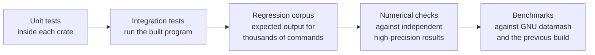

# Testing

Fastmash's job is to give the same answers as GNU datamash, faster, and to give
them identically on every supported machine. Testing is organized around those
three claims: **correctness**, **compatibility** and **performance**.


<!-- description: Testing layers, from narrowest to broadest: unit tests inside each crate, integration tests that run the built program, the regression corpus of expected output for thousands of commands, numerical checks against independent high-precision results, and benchmarks against GNU datamash and the previous build. -->

## Quick start

These checks cover application changes. Documentation-only changes use the
[website checks](#website-checks). Run from the repository root on Linux x86-64
or WSL2. The native Apple Silicon development gate below runs on macOS 15 and 26.

```sh
cargo fmt --all --check                  # formatting
cargo clippy --workspace --all-targets -- -D warnings   # lints
cargo build --locked --manifest-path release/publication-test-server/Cargo.toml --target-dir target --bins
cargo test --release --workspace         # unit and integration tests
cargo build --release --workspace        # the binaries the corpus runs
target/release/fastmash-corpus --binary target/release/fastmash --expected-version 0.2.0
target/release/fastmash-corpus --binary target/release/fastmash --expected-version 0.2.0 --stdin-file
```

Run the full suite with `--release`: memory-limit tests exercise the optimized
CLI. Debug builds can exceed those limits before reaching the behavior under test.
Installer tests exercise both Linux and macOS archive layouts, so Linux test
environments also need `shasum` on `PATH`. On Arch-based systems, it is supplied
at `/usr/bin/core_perl/shasum`; add that directory to the test environment's
`PATH` if needed.

Build the private release tools before the workspace tests. Installed-release
tests invoke the prepared checker without starting another Cargo build. If the
tools are built elsewhere, set `FASTMASH_INSTALLED_CHECKER` and
`FASTMASH_INSTALLED_PLATFORM_FIXTURE` to their executable paths.

A change is ready for review when all of these checks pass locally. CI also runs
on pushes and pull requests against `main` once the repository is public;
private automatic runs skip their jobs, while manual runs remain available.

## Layers

### Unit tests

Each crate carries unit tests next to the code they test. Together with the
integration tests there are more than 400 test functions, many of them
table-driven over hundreds of inputs. They cover option and grammar parsing, record splitting, every
operation's edge cases (empty groups, NaN, signed zero, infinities, overflow),
number parsing and formatting, and the arithmetic primitives.

```sh
cargo test -p fastmash-portable-numerics   # one crate
cargo test -p fastmash grammar             # tests whose names match "grammar"
```

For changes to the private installation and publication tools, also run:

```sh
cargo fmt --manifest-path release/publication-test-server/Cargo.toml --check
cargo clippy --manifest-path release/publication-test-server/Cargo.toml --target-dir target --all-targets --locked -- -D warnings
cargo test --manifest-path release/publication-test-server/Cargo.toml --target-dir target --locked
```

These tests also cover native archive byte and deployment checks. The macOS
archive builder prepares its checker in temporary storage and runs it against
the built executable and actual `xcrun vtool` metadata. Release mode also
compares the two clean executable builds with this checker.

For locale tooling checks, run:

```sh
cargo test --release -p fastmash-locale-tools
```

Portable fixtures cover numeric generation, comparison plans, stderr byte
normalization, collation-table projection, fixed digit and punctuation word lists,
output-order comparison and collation reports. Retained report bytes and partial
verification history are preserved, including all historical differences. Collation
verification updates accept the original producer's format and refuse unsupported
prior fields or record order. Unix tests exercise comparison
execution and both command interfaces with fixed local fixtures. Linux/glibc
also exercises the numeric generator with the installed POSIX locale and an
invalid locale. Numeric generation and comparison use the Rust tools. The
collation generation and comparison commands below use independent native
references and pinned Unicode data.
The numeric emitter's header names its actual
`fastmash-generate-numeric-locales` command. This provenance-only difference from
legacy emission leaves the table body and data unchanged.

Build the compiled locale tree with the reference's `localedef --no-archive`, using its
`SUPPORTED` list. Include each UTF-8 entry without a modifier under its listed
name, keeping names without a codeset suffix bare. Include every modifier entry,
even if it lists another character set, compiled with UTF-8 under
`NAME.UTF-8@MODIFIER`. Its generated table key remains `NAME@MODIFIER`. Keep the
modifier after the codeset suffix and do not replace it with its base locale,
since their numeric rules can differ.

For example, compile a modifier with:

```sh
localedef --no-archive -i nan_TW@latin -f UTF-8 /path/to/compiled-locales/nan_TW.UTF-8@latin
```

To generate numeric JSON and Rust source from the compiled locale tree, run:

```sh
cargo run --release -p fastmash-locale-tools --bin fastmash-generate-numeric-locales -- \
  --ldd /path/to/reference/bin/ldd --locale /path/to/reference/bin/locale \
  --uname /path/to/reference/bin/uname -- /path/to/compiled-locales \
  /tmp/fastmash-numeric.json /tmp/fastmash-numeric.rs
```

Run in the identified reference environment with its matching glibc tools and
compiled locale data. The generator queries native tools rather than the
product's built-in tables, so the host's default locale data is not a substitute
for that reference.
Use fresh output paths and keep the generated files separate from the committed
tables until their data and behavior have been checked.

The numeric comparator accepts explicit candidate and reference executables,
compiled locale data and the numeric JSON. By default it checks one locale for
each distinct combination of decimal separator, thousands separator and grouping
rules. Each run retains raw evidence in a new directory.

```sh
cargo run --release -p fastmash-locale-tools --bin fastmash-compare-numeric-locales -- \
  --evidence /tmp/fastmash-numeric-comparison -- /path/to/fastmash \
  /path/to/reference /path/to/compiled-locales data/locales/glibc-lc-numeric.json
```

Run the comparison in the same reference environment. Check its options with:

```sh
cargo run --release -p fastmash-locale-tools --bin fastmash-compare-numeric-locales -- --help
```

To regenerate collation candidates, first query the independently installed
ICU 78 reference with the [separate development tool](https://github.com/pederbe/fastmash/blob/main/tools/icu-exemplars/README.md).
Then probe an identified GNU sort with the matching compiled glibc locale tree:

```sh
cargo run --locked --manifest-path tools/icu-exemplars/Cargo.toml --target-dir target -- \
  data/locales/glibc-lc-numeric.json /tmp/fastmash-icu-exemplars.json
cargo run --release -p fastmash-locale-tools --bin fastmash-generate-collation-candidates -- \
  --evidence /tmp/fastmash-candidate-evidence -- \
  data/locales/glibc-lc-numeric.json /tmp/fastmash-icu-exemplars.json \
  /path/to/gnu-sort /path/to/compiled-locales /tmp/fastmash-candidates.json
```

The files and evidence directory must be new. The exemplar snapshot must identify
ICU 78 and contain exactly the numeric reference's locale names. GNU sort receives
`a` then `A` through a pipe, the literal locale name followed by `.UTF-8`, and
only `PATH=/usr/bin:/bin`, `LC_ALL`, `LOCPATH` and `TZ=UTC` in its environment.
Each probe has the retained 300-second budget. Arguments, input, output and
wait receipts remain in the private evidence directory. Failed probes,
diagnostics and unexpected output stop generation rather than guessing case
order. Successful output preserves the retained candidate JSON layout.

To generate glibc's treatment of characters apart from letters, use the
identified reference's GNU sort, glibc locale command, compiled locale tree and
`iso14651_t1_common` source:

```sh
cargo run --release -p fastmash-locale-tools --bin fastmash-generate-glibc-collation -- \
  --evidence /tmp/fastmash-glibc-captures -- /path/to/gnu-sort \
  /path/to/reference/bin/locale /path/to/compiled-locales \
  /path/to/reference/iso14651_t1_common /tmp/fastmash-glibc.json /tmp/fastmash-glibc.rs
```

Both output files and the capture directory must be new. The command probes the
sorting locales compiled from `crates/cli/src/collation_locales.rs`. Use repeated
`--locale NAME` options for a qualification subset. A subset's common character
ranges describe only those selected locales, so keep its output separate from
the complete table. Each locale must load as UTF-8 without diagnostics. Only
`LC_COLLATE` changes, with all other locale categories set to `C`.

The command reads the source's ignorable character order and named contractions.
Pinned independent Unicode 16.0.0 data supplies canonical decompositions, names,
and letter and number categories. Stable GNU sort comparisons in both input
orders distinguish ties from unequal strings. NUL records preserve tabs and
newlines in probe strings. Every native batch retains its arguments, input,
output and wait receipt, with a 300-second execution budget. Missing locales,
failed comparisons, inconsistent observations and values that cannot fit the
Rust table's types stop generation. The JSON preserves source hashes and the
retained layout. The Rust header names the new generator. Review generated
candidates before changing any committed table.

To project the retained collation verification data into a new Rust file, run:

```sh
cargo run --release -p fastmash-locale-tools --bin fastmash-generate-collation-table -- \
  data/locales/collation-verification.json /tmp/fastmash-collation.rs
```

The output must not already exist. `--variant N` selects each locale's candidate
at the signed index `N` from `data/locales/collation-candidates.json` instead. Negative
indices count from the end of each locale's list. This command projects supplied
data without probing a native collator or updating a product table.

To verify a candidate's alphabet, digits and script blocks, first project the
selected variant with `fastmash-generate-collation-table --variant N` and build a
separate measurement executable using that table. Then run:

```sh
cargo run --release -p fastmash-locale-tools --bin fastmash-verify-collation-locales -- \
  --variant 0 --evidence /tmp/fastmash-verification-captures \
  --prior data/locales/collation-verification.json --locale en_US -- \
  data/locales/collation-candidates.json /path/to/measurement-fastmash \
  /path/to/reference /path/to/gnu-sort /path/to/compiled-locales \
  /tmp/fastmash-verification.json
```

Use the same variant for projection, the measurement build and verification.
The verifier records the supplied variant without changing the executable's
compiled table. Omit `--locale` to check every candidate locale. The verifier
also checks `en_US` as the baseline, preserves prior variant history, and selects
each locale's first verified candidate in the completed report. Word planning
uses the retained independent Unicode 15.0.0 data, distinct from the glibc
generator's Unicode 16.0.0 decomposition data. Native ordering differences remain
report observations. Capture or input failures leave partial evidence and no
completed report. The report and capture paths must be new.

To compare the fixed punctuation workload against an identified native reference,
use explicit executables, GNU sort and matching compiled locale data:

```sh
cargo run --release -p fastmash-locale-tools --bin fastmash-compare-collation-punctuation -- \
  --evidence /tmp/fastmash-punctuation-evidence --locale en_US --locale tk_TM -- \
  data/locales/collation-verification.json /path/to/fastmash /path/to/reference \
  /path/to/gnu-sort /path/to/compiled-locales /tmp/fastmash-punctuation.json
```

Both the report file and evidence directory must be new. Without `--locale`, the
command selects every verification entry with a nonempty final tag. Repeated
selections form a subset in the source's sorted name order. Names are kept
literally and receive the original `.UTF-8` suffix. Each candidate and reference
invocation receives all 1,983 punctuation words through a pipe, with a 300-second
execution budget and the existing cleanup reserve. Raw arguments, environment,
input, output, delivery and wait receipts remain in the private evidence directory.

The command prints the existing punctuation summary and writes its report format.
Order differences and native nonzero statuses remain report observations and do
not make a completed report a command failure. Spawn, transport and strict
first-field UTF-8 decoding errors stop the run with partial evidence and no
completed report. Successful stderr is retained without rejecting the result.
This command covers fixed punctuation only. Use the verifier above for letters,
digits and script blocks.

### Integration tests

`crates/cli/tests/` runs the compiled `fastmash` binary as a user would:
arguments, standard input, standard output, standard error and exit status.
Each file covers one area, such as grouping, selectors, quantiles, record
separators or pipeline failures (closed pipes, unreadable input, full disks).

For a focused `native_streams` or `grouping` run, or
`text_summaries`, `quantiles`, `dispersion`, `extrema`, `sum_mean`,
`presentation` or `selectors` on macOS, first build the child-only launcher with
`cargo build --release --locked -p fastmash-corpus-driver --bin fastmash-test-process`.
The `weighted_mean` and `csv_input` resource fixtures also need this launcher on
both platforms.
Workspace tests build it automatically. Set `FASTMASH_TEST_PROCESS` to use a
prepared launcher elsewhere. It sets alarms and selected signal masks in a fresh
process, creates broken pipes without shared readers, then replaces itself with
the tested executable. The tests retain its PID and actual signal status.

The macOS full-output checks in these suites own a calibrated full destination
until the tested child has been reaped and its parent-side handles are closed.
They then verify cleanup. Failed cleanup retains the private image and evidence.
The weighted-mean and CSV zero-file-size fixtures use child-only POSIX shell
setup to ignore SIGXFSZ before the Rust launcher applies the actual limit. A native
control raises the unblocked signal across exec and verifies the limit and PID.
The quantile suite retains a 60-second bound for ordinary Commands and a
30-second bound for full-output checks on macOS.
Grouping's resource fixtures apply file-size and Linux address-space limits in
the fresh child. The file-size check uses native spawn attributes to restore
SIGXFSZ only in that child, with real output pipes and signal status. The paused
memory check retains the tested process's PID across exec.

For focused `record_separators` tests, prepare both launchers with
`cargo build --release --locked -p fastmash-corpus-driver --bins`.
Set `FASTMASH_TEST_CORPUS` to use a prepared copy elsewhere. Ordinary-output
read-error fixtures observe the exact input queued in a raw terminal before
releasing the executable. They wait for that queue to drain while the child is
alive, observe the child stopped,
then reclaim the foreground and resume it to produce real `EIO`. This is an input
drain observation, not proof of parsed records or an output acknowledgement.
The existing corpus cases still require their visible output acknowledgement.
Commands that reject input earlier retain their actual error output and status,
with no claim that a later read encountered `EIO`.
Combined read-error/full-output fixtures borrow the calibrated full destination
through the same coordinator and retain it until both processes are reaped. They
keep candidate stderr separate from the cancellation channel. Calibration checks
the selected executable's path and hash, including the named GNU 1.9 reference.
Native qualification sets `FASTMASH_RECORD_FAULT_EVIDENCE` to a prepared private
directory. Completed combined cases retain input observations, selected-sink
calibration and native detach receipts there after child and sink cleanup.
The record suite forbids unsafe code. Its Linux memory-refusal fixtures apply the
same 32 MiB address-space limit through the fresh process launcher.

A child can become unsignalable on macOS just before its terminal status is
observable. Stop selection keeps its PID owned and waits within the existing
execution deadline for a successful stop or a fresh terminal observation. The
regression control repeats a post-read parse failure during descriptor teardown;
an earlier exit never counts as observed late EIO.

Native tests use the same command boundary. `native_descriptors.rs` covers closed
and incorrectly opened standard streams. `native_streams.rs` covers inherited
signals, terminal buffering and output faults; `native_sort.rs`
covers stable sorting, quoted CSV, complete records, selection, weighted
calculations, hash restart, piped replay, supported locales and forced spill.
Its interruption checks wait until a private run has been opened and unlinked
before sending a signal, then check temporary-storage cleanup. The ordinary CLI
suites still cover all operation families and the table-health, CSV, selection,
comparison and presentation extensions.

When you fix a bug, add an integration test that reproduces it.

### Regression corpus

The regression corpus is a set of more than 3,000 commands, each with its
exact expected standard output, standard error and exit status. Expected
results for compatible behavior were observed from GNU datamash 1.9, running
each case twice, on the reference hosts. Cases where Fastmash intentionally
differs record Fastmash's documented behavior instead; the
[differences page](https://fastmash.io/guide/differences.html) gives the
reasons.

```sh
cargo build --release --workspace   # candidate, Sort supervisor and corpus driver
target/release/fastmash-corpus --binary target/release/fastmash --expected-version 0.2.0 --keep-going
target/release/fastmash-corpus --help
```

A run stops at the first mismatch and prints the case, the expected bytes and
the actual bytes. The cases give their input through a pipe; `--stdin-file` runs
those with ordinary input again with standard input as a regular file, against the same
expectations. Both modes need coverage: hash grouping applies to eligible files
and to eligible piped input in language locales, with different replay paths.
The frozen fixture and its provenance record stay byte-identical across platforms.
The unpublished Rust driver in `crates/corpus-driver/` executes the 2,857 ordinary
cases in both modes. Its default run also executes 22 directory-input and 51
closed-output-pipe cases, 72 full-output cases and 65 early commands with stdin
held open, plus 67 held-output observations and three acknowledged late-input
errors. Regular-file mode records why each other case belongs to the default
Rust run. Its `--keep-going` and `--evidence-dir` options retain every case's
disposition and outcome. CI runs this same driver on Linux, native macOS 15 and
26, and the executable installed from the native archive.
For a development version, pass `--expected-version VERSION`, using the version
in `crates/cli/Cargo.toml`.
On macOS, the corpus driver requires no supervisor. It uses a private full
filesystem for output faults and controlling-terminal job control for input
faults. The separate Rust command tests retain the native fault helpers below. `--evidence-dir` retains the executable and fixture hashes, per-case
dispositions, native observations and mismatches. Regular-file mode records the
transport cases it leaves to the piped run, instead of silently excluding them.

### Compatibility cases

A change that affects observable behavior (output, a diagnostic, an exit
status) needs a matching expectation. For behavior that should match GNU
datamash, compare against a real `datamash` 1.9 and record what it does. For
an intended difference, update
[Differences from GNU datamash](https://fastmash.io/guide/differences.html)
in the same pull request.

### Numerical checks

Fastmash promises identical numerical results across machines, so
arithmetic changes get extra scrutiny:

- Arithmetic primitives are tested against independently computed,
  high-precision reference values.
- `log` and `exp` results are checked against an independent
  arbitrary-precision library (MPFR), with emphasis on inputs whose results lie
  close to a rounding boundary.
- Numerical rules are versioned together. A change to any numerical output
  is deliberate, reviewed and listed in the changelog, never silent.

The native release workspace run includes every retained `v3` primitive and
exact-helper row in `crates/portable-numerics/testdata/`, the exact conversion
tests, and the independent MPFR logarithm/exponential challenge and range-boundary
fixtures in the CLI. `record_separators::reproducibility` executes representative
portable expectations through the command itself, including extreme exponents,
ordered numerical calculations and fixed random vectors. The installed command
run repeats those CLI expectations. No host GNU result replaces a fixture or
changes the `portable-binary80-v3` profile. Generating new MPFR reference data and
running optional reference-host measurements are separate from consuming these
already retained independent fixtures.

### Benchmarks

Performance claims come from **representative jobs**: real and synthetic
datasets with the commands people run on them, grouped into **job families**
such as decimal sums, quantiles and grouped text. Each job is timed for GNU
datamash 1.9, the previous Fastmash build and the candidate, on the same host,
alternating runs to reduce noise.

A performance change is accepted when it is faster on its target jobs and no
existing job becomes materially slower (the **predecessor guards**). See the
[benchmark method](https://fastmash.io/benchmarks/method.html) for datasets,
margins and hardware.

## Supported test environment

| | |
| --- | --- |
| OS | Linux x86-64 with glibc, or WSL2 |
| Kernel | 5.11 or later, for the external sort route |
| Tools | Stable Rust (see `rust-version` in `Cargo.toml`), GNU or uutils coreutils `sort`; Python 3.10 or later for website checks |
| Temporary storage | A writable `TMPDIR`, such as ext4 or tmpfs |

Under WSL, keep the checkout and `TMPDIR` on the Linux filesystem rather than a
Windows drive: tests are much faster there.

## Native Apple Silicon development gate

`macos.yml` requires actual `Darwin`, `arm64`, the expected macOS major version
and the `aarch64-apple-darwin` compiler host. Both `macos-15` and `macos-26` run
formatting, warnings-denied Clippy, the complete applicable release workspace
tests, and all 3,137 frozen cases with piped input plus the ordinary-input cases
with regular-file input. Successful version actions use the explicit development
version; their error and transport expectations stay frozen.

The jobs build the native Rust test transports explicitly and record their
hashes. To run the same gate locally on a native supported Mac, create those
helpers outside the checkout and name them before running the quick-start
commands. This shell block uses Bash:

```bash
bash -c '
set -euo pipefail
helpers=$(mktemp -d)
trap '\''rm -rf "$helpers"'\'' EXIT
rustc --edition=2024 --crate-type=cdylib -C panic=abort -C opt-level=2 crates/cli/tests/support/full_output_interposer.rs -o "$helpers/full-output.dylib"
rustc --edition=2024 -C panic=abort -C opt-level=2 crates/cli/tests/support/full_output_probe.rs -o "$helpers/full-output-probe"
export MACOSX_DEPLOYMENT_TARGET=15.0
export FASTMASH_TEST_FULL_OUTPUT_LIBRARY="$helpers/full-output.dylib"
export FASTMASH_TEST_FULL_OUTPUT_PROBE="$helpers/full-output-probe"
cargo fmt --all --check
cargo clippy --workspace --all-targets --locked -- -D warnings
cargo build --locked --manifest-path release/publication-test-server/Cargo.toml --target-dir target --bins
cargo test --release --workspace --locked
cargo build --release --workspace --locked
version=$(sed -n '\''s/^version = "\([^"]*\)"$/\1/p'\'' crates/cli/Cargo.toml | head -n 1)
target/release/fastmash-corpus --binary target/release/fastmash --expected-version "$version"
target/release/fastmash-corpus --binary target/release/fastmash --expected-version "$version" --stdin-file
'
```

The fixture's stdout and exit-status expectations apply unchanged on macOS.
These named dispositions adapt observation or diagnostics only:

| Mechanism or frozen case | Native disposition |
| --- | --- |
| Rust full-stream tests | A test-only dyld interposer returns `-1` with native `ENOSPC` for the selected stdout or stderr descriptor. A Rust probe checks the actual return and errno, ordinary and unselected writes must remain exact, and the actual candidate must pass calibration before a fault result is accepted. Linux keeps `/dev/full`. |
| All 72 `io=full` corpus cases | The Rust corpus driver uses a private 8 MiB HFS+ image filled to real `ENOSPC`. Actual executable controls calibrate selected and unselected streams, with empty-sink checks before and after each case. Destination facts and owned-image cleanup are retained. Linux uses `/dev/full`. |
| `grouping-next:read-error`, `grouping-next:read-error-header`, `paired-private:grouped-read-error-after-result` | The corpus driver observes the frozen visible completed-group acknowledgement, stops the candidate, reclaims the controlling terminal foreground and resumes it. The next read produces real `EIO` without wake bytes on both platforms. Final stdout, stderr and status 1 stay frozen. |
| `sorting/header-empty`, `sorting/header-only-comments`; native calculations in `record_separators::record_intake::missing_headers_keep_native_and_external_full_warning_order`; ordinary aggregates in `weighted_mean::sorted_named_empty_completion_keeps_header_errors_and_legacy_commands` | Native sorting on Linux and macOS reports exactly `fastmash: missing input header for named grouping key`, with empty stdout and status 1. It emits no full warning because the data phase has not begun. The fixture remains frozen; only these two named corpus diagnostics are adapted. |
| `rms` in `record_separators::record_intake::missing_headers_keep_native_and_external_full_warning_order` | Linux's external route retains the system-sort error, then the full warning and `read error (on close)`. macOS uses the native missing-header diagnostic without a full warning. Both require empty stdout and status 1. |
| `weighted_mean::weighted_numeric_sort_eligibility_and_system_composition_are_exercised`; mixed paired calculations in `weighted_mean::sorted_named_empty_completion_keeps_header_errors_and_legacy_commands` | Paired-operation composition uses the native Sort route on macOS and retains the system Sort route on Linux. Each platform checks its required route trace while report bytes stay identical. |
| `grouping-reference-r2:held-flush-pipe`, `grouping-reference-r2:held-flush-pipe-header`, `output-header-lifecycle:held-8192`, `header-writer-reference:pipe-large` | The held prefix follows the actual destination's `fstat` block size, capped at 8,192 bytes, with a zero size using 8,192. Prefix bytes are derived from the frozen output and the known pre-EOF output, rather than candidate output. The destination facts are retained. Final stdout, status, live held process and terminal line buffering remain checked. |
| `/usr/bin/timeout` in shared direct-command helpers | A native pre-exec alarm bounds the command without a GNU utility dependency. Linux keeps its existing timeout wrapper. |
| Linux temporary-root and PTY metadata assumptions | Native helpers use private temporary directories and native descriptor metadata. Raw terminal flags and actual terminal behavior remain checked. |
| Spill unit tests `exhausted_merge_inputs_are_released_before_the_merge_ends`, `streaming_merge_and_truncated_runs_report_failures`, `full_fan_in_initialization_and_partial_consumer_failures_propagate` | Native `fstat` identity checks verify early descriptor release. Linux retains `/dev/full`; Darwin uses a read-only `/dev/null` descriptor and its native `EBADF` to check immediate spill-write and buffered final-flush error propagation. Native CLI tests separately check calibrated `ENOSPC`. |

The following exclusions are specific to Linux mechanisms. They remain in the
Linux gate; generic suites are not disabled wholesale on macOS:

| Test or component | Reason and native coverage |
| --- | --- |
| All 16 tests in `external_sort.rs`, listed below, and the external implementation's `sort-process` unit tests | They inspect or fault the Linux-only supervisor, pidfds, `close_range`, seccomp, child `/proc` entries or GNU sort scheduling. macOS never enters that route. Native sorting, bad `TMPDIR`, interrupted anonymous spill, long headers, separator bytes and inherited cancellation behavior are tested at the executed-command boundary. Sort supervisor identity and child-supervisor security have no native component. |
| `routing_tests::sigpipe_policy_in_isolated_test_processes`, `routing_tests::sigpipe_child` | Their subprocess harness installs raw Linux syscall layouts. `native_streams` checks the actual CLI's blocked and ignored signal inheritance, closed pipes, startup actions and sorted/comparison/health modes through native APIs. |
| `diagnostic_color::child_sort_diagnostics_are_forwarded_without_generated_styling` | No child sort emits a diagnostic on macOS. `native_missing_header_diagnostic_receives_the_selected_style` checks the native diagnostic and selected styling instead. |
| `grouping::native_variable_allocation_refusal_is_explicit`; `text_summaries::text_allocation_failure_is_explicit`; `record_separators::transpose::transpose_allocation_failure_is_explicit_and_has_no_output`; `record_separators::crosstab::crosstab_allocation_failure_is_explicit` | These faults depend on Linux address-space enforcement and calibrated small glibc process limits. Darwin address-space limits do not provide that fault. Checked-allocation unit fixtures, growable command tests and native spill refusal/error paths still run; these particular real allocation-failure thresholds remain Linux evidence. |
| `grouping::eight_thread_language_sorts_use_a_fraction_of_an_address_space_limit`, including its `paused_language_sort` helper | The measurement inspects Linux `/proc/PID/status` and glibc arena reservation under `RLIMIT_AS`. macOS uses its documented conservative initial chunk target when Linux memory facts are unavailable; explicit small targets, language sorting and spill remain tested natively. |
| `text_summaries::text_final_output_is_written_without_a_second_copy` | Its calibrated 32 MiB address-space allowance is a Linux observation. The native test still checks the full large output; it does not claim that Linux allocation threshold on Darwin. |
| Ignored `quantiles` tests `growth_and_sort_scratch_exhaustion_are_reported`, `percentile_and_trim_allocation_failures`, `robust_allocation_failures`, `dedup_allocation_failure_and_duplicate_heavy_stream` | These opt-in Linux installed-binary tests require the calibrated address-space fault. Ordinary quantiles, robust operations, sample growth and output faults remain in the native run. |
| Ignored `installation::installed_pair_and_missing_companion` | It requires a Cargo-installed Linux executable and Sort supervisor pair. The native archive installation test and standalone native-sort commands cover installation, startup and sorting without that component. `installed_migration_examples` runs explicitly against the native archive. |
| Other existing ignored named-reference, retained-dataset, locale-generation and timing tests | Their explicit reference, dataset or measurement prerequisites remain unchanged on both platforms. The retained workspace inventory and result log name them and their reasons. Native GNU comparisons are recorded separately, and cannot redefine portable expectations. |

The excluded external-sort tests are:

- `exec_sort_accepts_only_its_own_temporary_root`
- `the_exec_role_exits_77_whatever_its_standard_error`
- `scratch_rejects_a_preexisting_directory`
- `scratch_rejects_a_preexisting_symlink`
- `external_sort_uses_tmpdir_and_cleans_it`
- `external_sort_threads_follow_gnu_sort_defaults`
- `unusable_tmpdir_is_a_clear_error`
- `unusable_tmpdir_sorts_small_input_in_process`
- `a_separator_byte_from_0x80_sorts_in_process`
- `a_missing_supervisor_sorts_in_process`
- `without_close_range_cloexec_jobs_sort_in_process`
- `interrupted_external_sort_leaves_no_temporary_directory`
- `a_killed_sort_is_named_before_read_error_on_close`
- `a_long_header_in_a_file_is_read_in_chunks`
- `ignored_cancellation_signals_fall_back_to_native_sorting`
- `a_companion_from_another_release_is_named`

After both source gates pass, one macOS 15 job builds the checksummed development
archive with a macOS 15 deployment target. Both installation jobs download those
same bytes, execute the documented method outside the source checkout, and check
checksum/download failure preservation. They repeat both corpus modes and the
ordinary CLI suites through the installed executable, with explicit executable
overrides. The existing opt-in prepared quantile headers, wide sorted headers
and migration-example tests also run because their installed-binary prerequisite
is then available. The hosted comparison example records exact candidate and GNU
identities, output eligibility, seven alternating samples and observed variation.
Its GNU installation serves this comparison only; installation itself requires
neither Rust nor GNU coreutils.

Evidence lives under the runner's temporary directory and is retained as CI
artifacts: source revision, actual OS, compiler and flags, manifests, frozen
fixture hashes, native helper hashes, binary/archive hashes, test inventories,
logs, per-case dispositions and hosted comparison data. The checkout stays clean
for archive provenance. A prepared workflow or an Apple-target compile check is
not native runtime evidence, release qualification or a performance claim.

## Website checks

Changes confined to `docs/` and Markdown files need the website build, local
link check and public-reference check:

```sh
python3 -B scripts/check_public_references.py
bash scripts/build_site.sh
lychee --offline --no-progress --fallback-extensions html --index-files index.html --root-dir docs/book docs/book
```

Set `MDBOOK` to an installed mdBook 0.5.4 to reuse it.

The landing-page browser tests cover initial loading with a delayed script,
installation tabs, clipboard fallback, reduced motion and access to every
installation command without JavaScript. They use Puppeteer from the existing
diagram tooling and its installed Chrome browser. For setup, see
[the demo tooling](https://github.com/pederbe/fastmash/blob/main/scripts/demo/README.md).

For changes to website code, also run the browser checks:

```sh
npm run test:landing
npm run test:docs
```

Use mdBook 0.5.4, as pinned by `scripts/build_site.sh`. Rebuild the book before
running the site builder again, since the builder transforms the generated HTML.

## Continuous integration

| Workflow | When | What |
| --- | --- | --- |
| `ci.yml` | Public pushes and pull requests against `main` with application or tooling changes, or manual dispatch | Format, Clippy, release-mode tests, regression corpus on Ubuntu. Required jobs skip documentation-only changes |
| `macos.yml` | Public pushes and pull requests against `main` with application or tooling changes, or manual dispatch | Complete native source checks on macOS 15/26, one development archive, both installations, installed command/corpus checks and scoped hosted GNU observations |
| `docs.yml` | Public pushes and pull requests against `main`, or manual dispatch | Builds the website and checks links |
| `release.yml` | Manual dispatch on a version tag | Builds and tests release assets, then creates a draft release |
| `package-repository-checks.yml` | Public pushes and pull requests changing package-repository tooling, or manual dispatch | Checks shell and Rust tooling, then apt/dnf clients across interrupted and interleaved uploads using signed fixture packages |
